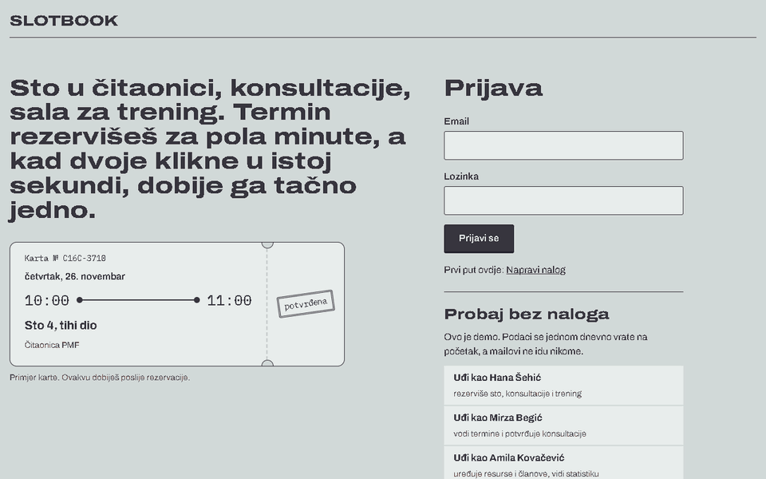

# SlotBook

[](https://github.com/eminahbabovich/SlotBook/actions/workflows/ci.yml)

SlotBook je aplikacija za rezervaciju termina u čitaonici, teretani, sali za sastanke ili na konsultacijama. Danas se to dogovara porukama u grupi ili u tabeli, pa se termini preklapaju i niko ne zna ko je šta uzeo. U SlotBooku preklapanje odbija sama baza, pa dvoje ne dobije isti termin ni kad kliknu u istoj milisekundi. Svaka organizacija ima svoje resurse, osoblje, klijente i vremensku zonu.

Aplikacija je na **https://slot-book-delta.vercel.app**. Na prijavi su tri demo računa (klijent, provider i admin) i ulazi se jednim klikom, bez registracije.



U GIF-u Hana uđe u demo, otvori sto u Čitaonici PMF, uzme slobodan termin i dobije kartu, pa je vidi u Mojim rezervacijama. Okviri su Playwright screenshotovi pojedinih koraka, pa pokret između njih nije gladak kao u aplikaciji.

## Šta je ovdje zanimljivo

### Dvadeset istovremenih klikova, jedan termin

Preklapanje rezervacija istog resursa odbija PostgreSQL, preko `EXCLUDE USING gist` constrainta. Provjera u Javi ne bi bila dovoljna, jer dva zahtjeva koja stignu u istom trenutku oba vide slobodan termin. `BookingIstovremenoApiTest` šalje 20 zahtjeva za isti termin kroz pravi HTTP server, u četiri runde. U svakoj prođe tačno jedan, a ostalih 19 dobije `409`. Prva verzija je padala u deadlock (`40P01`), pa rezervacija sad prvo zaključa resurs. Isti test pokazuje da grupni trening s 5 mjesta pusti tačno 5, i da deset zahtjeva s istim `Idempotency-Key` napravi jednu rezervaciju.

### Ljetno vrijeme ne pomjera termine

Radno vrijeme je lokalno, u zoni organizacije (`Europe/Sarajevo`), a termini su u bazi `TIMESTAMPTZ`. Pravilo "ponedjeljkom od 08:00" daje termin u 08:00 po satu na zidu i zimi (+01:00) i ljeti (+02:00). `SlotCalculatorTest` to provjerava preko obje granice. U noći kad se sat vraća, pravilo od 00 do 04 ima pet satnih termina, a ne četiri. Kad sam za probu uzeo pomak zone za trenutak upita umjesto za datum termina, pala su sva četiri DST testa.

### Organizacija ne dira tuđe podatke

`OrganizationIsolationApiTest` prođe svaki endpoint nad organizacijom s tokenom admina druge organizacije i provjeri da dobije `403` i da se u bazi ništa ne promijeni. Uz to proba klijenta, providera drugog resursa iz iste organizacije i zahtjev bez tokena. Spisak ruta test čita iz samog Springa, pa padne i kad dodam endpoint koji u njemu nije. Uhvatio je upload slike bez `@PreAuthorize`, kroz koji je admin druge organizacije stvarno stavio sliku na sto u tuđoj čitaonici.

### Webhook koji je vraćao novac četiri puta

Stripe isti događaj zna poslati više puta, i to u isto vrijeme. `StripeWebhookApiTest` šalje pet istih dostava u istom trenutku. U prvoj verziji je za ispravno plaćen termin novac vraćen četiri puta. Sad dostavu obradi tačno jedna, a ostale ništa ne mijenjaju.

## Šta aplikacija radi

Organizacija upiše resurse (sto, salu, teren, termin konsultacija) i radno vrijeme s izuzecima, pa pozove članove mailom ili pozivnim linkom s QR plakatom. Članovi rezervišu u kalendaru koji se sam osvježi kad neko drugi uzme termin. Na zauzet termin se mogu upisati na listu čekanja, termin mogu ponoviti svake sedmice, platiti karticom (Stripe u test modu) i pratiti u Google ili Apple kalendaru. Dolazak se potvrđuje QR kodom, a potvrde, ponude i podsjetnici stižu mailom i kao push obavijest. Admin vidi popunjenost po mjesecima, postavlja pravila (koliko rezervacija po osobi, blokada poslije nedolazaka) i može na vrata staviti tablet koji pokazuje današnje termine.

Cijeli tok po fazama, sa screenshotovima, je u [docs/HISTORIJA.md](docs/HISTORIJA.md).

## Kako je nastao

Ovo je moj drugi projekat, poslije [RoomSplita](https://github.com/eminahbabovich/roomsplit). Backend učim od nule, pa je cilj bio da svaku liniju mogu objasniti. Učio sam uz AI mentora (Claude): on objašnjava i predlaže, a ja pokrećem, provjeravam i pitam dok ne razumijem.

Rad je išao u fazama iz [PROJECT_PLAN.md](PROJECT_PLAN.md). Od 14 faza gotovo je 13, a Faza 14 (AI asistent za rezervacije, na besplatnom Groq nivou) je u izradi. Odluke i zašto sam ih donio su u [docs/ODLUKE.md](docs/ODLUKE.md). Šta sam naučio i gdje smo griješili, i ja i Claude, piše u [LEARNING_LOG.md](LEARNING_LOG.md).

## Tehnologije

Backend je Java 21 sa Spring Bootom 4.1.2 (Hibernate 7.4), PostgreSQL 17 i Flywayom za migracije. API dokumentuje springdoc 3.2.0. Testovi koriste JUnit i Testcontainers, pa idu na pravi PostgreSQL u Dockeru, ne na H2 ni na moju lokalnu bazu. Pokrivenost mjeri JaCoCo, a CI na svaki push pokreće testove i gitleaks nad cijelom git historijom.

Frontend je React 19 s Viteom 8, u JavaScriptu. Fontovi su self-hostani preko Fontsource paketa. Frontend je na Vercelu, backend na Renderu, a baza na Neon-u.

## Demo i produkcija

Vercel prosljeđuje `/api` na Render (`frontend/vercel.json`), pa je za browser sve na jednoj adresi. Backend direktno je na https://slotbook-dxvs.onrender.com: bez prijave odgovaraju samo [`/api/status`](https://slotbook-dxvs.onrender.com/api/status), [`/actuator/health`](https://slotbook-dxvs.onrender.com/actuator/health) i [Swagger UI](https://slotbook-dxvs.onrender.com/swagger-ui/index.html), a sve ostalo vraća 401, i adrese koje ne postoje. Koraci za deploy i šta sam poslije njega provjerio su u [docs/RUNBOOK.md](docs/RUNBOOK.md).

Render na besplatnom planu uspava servis poslije 15 minuta bez saobraćaja. Od 26.11.2026 ga UptimeRobot zove svakih 5 minuta. Prije toga je prvi zahtjev poslije pauze znao trajati dugo, 25.11. čak 207 sekundi.

Demo se pali profilom `demo`. Podaci su čitaonica i teretana s četiri sedmice rezervacija i svaki dan se sami vrate na početak. Profil na pokretanju obriše cijelu bazu, pa se pali samo na bazi koja služi za demo (zašto, piše u [docs/ODLUKE.md](docs/ODLUKE.md)). Može se napraviti i svoj nalog. Mail za potvrdu šalje Brevo preko porta 2525, jer Render na besplatnom planu blokira 465 i 587, ali zasad završi u spamu, jer je pošiljalac Gmail adresa umjesto vlastitog domena. Svoj nalog nestane kad se demo vrati na početak.

## Pokretanje lokalno

Treba ti Java 21 i Docker. Maven ne treba instalirati, projekat dolazi s `mvnw`.

Prvo napravi `.env` i u njemu promijeni lozinku baze. Ako ti je port 5432 već zauzet (meni jeste, drži ga baza iz RoomSplita), promijeni i `POSTGRES_PORT`. U `JWT_SECRET` ide nasumičan ključ od najmanje 32 bajta, kojim se potpisuju tokeni. Bez njega aplikacija ne starta. U PowerShellu ga napraviš ovako:

```powershell
$b = New-Object byte[] 48; [Security.Cryptography.RandomNumberGenerator]::Create().GetBytes($b); [Convert]::ToBase64String($b)
```

Za plaćanje trebaju `STRIPE_SECRET_KEY` (test ključ `sk_test_...` iz Stripe sandboxa, Developers, API keys) i `STRIPE_WEBHOOK_SECRET` (`whsec_...`, lokalno ga ispiše `stripe listen`). Bez njih aplikacija radi, samo plaćanje vraća `503`, a webhook `400`.

Za AI asistenta treba `AI_API_KEY`, besplatan ključ s console.groq.com (bez kartice). `AI_BASE_URL` i `AI_MODEL` imaju podrazumijevane vrijednosti za Groq i mijenjaju se samo za drugog provajdera. Bez ključa aplikacija radi, samo asistent javi da nije dostupan.

```powershell
copy .env.example .env
notepad .env
docker compose up -d
```

Spring ne čita `.env` sam, to radi samo Docker Compose. Prije starta ga učitaj u PowerShell prozor, pa pokreni aplikaciju:

```powershell
cd backend
Get-Content ..\.env | ForEach-Object {
    if ($_ -match '^\s*([^#=\s][^=]*)=(.*)$') {
        [Environment]::SetEnvironmentVariable($Matches[1].Trim(), $Matches[2].Trim())
    }
}
.\mvnw.cmd spring-boot:run
```

U IntelliJ-u se `.env` doda u run konfiguraciju (polje Environment variables, ili plugin EnvFile).

Kad aplikacija radi, Swagger UI je na http://localhost:8080/swagger-ui.html, provjera zdravlja na http://localhost:8080/actuator/health (i `/liveness`, `/readiness`), a Mailpit, lažni SMTP server koji hvata mailove, na http://localhost:8025.

Testovi traže da Docker radi, a `.env` ne treba:

```powershell
cd backend
.\mvnw.cmd test
```

Frontend traži Node (koristim 26) i radi na http://localhost:5173. Vite zahtjeve na `/api` prosljeđuje backendu na portu 8080, pa backend mora biti pokrenut. Vitest testovi rade i bez njega:

```powershell
cd frontend
npm install
npm run dev
npm test
```

Playwright testovi sami podignu svoju bazu i Mailpit (`frontend/e2e/compose.yml`, portovi 5434 i 8026), backend i Vite, i na kraju ugase kontejnere. Traže Docker i Microsoft Edge. Portovi 8080 i 5173 moraju biti slobodni, pa razvojni backend i `npm run dev` prvo ugasi. Svih devet testova je zadnji put trajalo 3,1 minut, najviše zbog starta backenda i čekanja mailova:

```powershell
cd frontend
npm run e2e
```

Za produkciju se uključuje profil `prod` (`SPRING_PROFILES_ACTIVE=prod`). Baza se tada spaja preko `DB_URL`, `DB_USER` i `DB_PASSWORD`, a port se uzima iz `PORT`. I tamo treba `JWT_SECRET`, i to drugi ključ od lokalnog.

## Testovi

Backend ima 595 testova i svi prolaze (zadnje pokretanje 26.11.2026). Frontend ima 337 Vitest testova i 9 Playwright testova, koji idu kroz pravi backend i pravu bazu: glavni tok (prijava, rezervacija, otkazivanje i termin koji neko uzme prije potvrde), lista čekanja, iCal link, kalendar koji se osvježi sam, serija od tri sedmice, QR dolazak, grupna soba i pozivni link. Raspored providera, statistika i forme admina su provjereni samo s lažnim backendom u Vitest testovima i u browseru.

JaCoCo je 15.11.2026 izmjerio 97,1 % linija glavnog koda (1385 od 1427), iz jednog čistog pokretanja, kad je testova bilo 334. Paket `stats` je pokriven cijeli. Najviše nepokrivenih linija ima `GlobalExceptionHandler` (12). Dva njegova handlera, za istovremenu izmjenu rezervacije (`@Version`) i za dvije istovremene pozivnice, provjerena su u servisnom testu, ali ne i kroz HTTP. Nepokriven je i dio opisa stanja u poruci o nedozvoljenom prelazu, grana u kojoj isti `Idempotency-Key` u istom trenutku stigne za dva različita resursa, i grana u kojoj se mail ne može ni sastaviti (`MessagingException`).

## Šta nije urađeno ili nije provjereno

Ovdje je ono za šta nemam dokaz na pravom uređaju ili na produkciji, i ono što sam namjerno ostavio nedovršeno.

- Push obavijesti nisam vidio na pravom telefonu. Na Renderu su VAPID ključevi postavljeni i push je uključen, ali Playwright pokreće Edge bez push servisa, pa pravu pretplatu kod Googlea ili Microsofta nisam dobio. Dokaz koji postoji je test koji poruku dešifruje kao browser i provjerava VAPID potpis (`PushApiTest`).
- PWA nisam instalirao na telefon. Manifest, ikone, service worker i stranicu "nema mreže" sam provjerio u Edgeu na računaru, na `vite preview`. E2e testovi idu na dev server, gdje service workera nema.
- Na iPhoneu push radi samo kad je SlotBook dodan na početni ekran (iOS 16.4+). Nijedan iPhone nisam probao.
- Ekran na vratima nisam držao na pravom tabletu ni TV-u. Wake Lock i cijeli ekran sam vidio samo u Edgeu na računaru, a stariji iPad bez Wake Locka treba ručno podesiti da se ne gasi. Svi ekrani iza iste IP adrese dijele granicu od 30 zahtjeva u minuti, pa deset ekrana u jednoj zgradi vjerovatno ne bi stalo.
- "Nađi slobodno" ima izmjeren broj SQL upita (5 po resursu), ali ne i vrijeme odgovora na Renderu i Neon-u.
- `npm audit` javlja 4 umjerene ranjivosti u alatu za build PWA (`workbox-build`). U produkcijskim paketima ih nema, a popravka koju nudi npm vraća plugin na verziju bez podrške za Vite 8.
- Slike resursa su na disku Rendera i nestanu sa svakim deployem. Cloudflare R2 traži karticu i za besplatni plan, pa ga nisam uključio ([docs/ODLUKE.md](docs/ODLUKE.md)). Demo podaci nemaju slika, pa se to vidi tek kad neko postavi svoju.
- Stripe na produkciji sam probao jednom uplatom i jednim povratom, skriptom. Istek neplaćene rezervacije (`checkout.session.expired`) na produkciji nisam čekao, provjeren je samo lokalno.
- AI asistent (Faza 14) za sada postoji samo na backendu. Alati, prijedlozi s dugmetom Potvrdi i petlja su provjereni testovima, ali s lažnim modelom koji radi ono što mu test zada. Pravi Groq model je odgovorio samo na jedan pozdrav, kroz razgovor o rezervaciji ga još nisam vodio. Widget ne postoji.

## Struktura i dokumentacija

`backend/` je Spring Boot aplikacija s paketima po funkcionalnosti (`ba.slotbook.booking`, `ba.slotbook.resource`...), ne po sloju. `frontend/` je React aplikacija (Vite, JavaScript), a Playwright testovi su u `frontend/e2e/`. Pozivi backenda su samo u `frontend/src/api/`, a boje, fontovi i razmaci samo u `frontend/src/tokeni.css`. `docker-compose.yml` diže PostgreSQL i Mailpit za lokalni razvoj.

CI je u `.github/workflows/ci.yml` (backend testovi, frontend lint, testovi i build, provjera zavisnosti na pull requestu, gitleaks). `.github/workflows/codeql.yml` analizira Javu i JavaScript, a `.github/dependabot.yml` jednom sedmično traži zastarjele zavisnosti (Maven, npm, GitHub Actions).

U `docs/` su:

- [HISTORIJA.md](docs/HISTORIJA.md): šta je urađeno u kojoj fazi, s ekranima redizajna
- [ODLUKE.md](docs/ODLUKE.md): odluke, između čega sam birao i šta nisam provjerio
- [ARHITEKTURA.md](docs/ARHITEKTURA.md): slojevi, tok zahtjeva i model podataka
- [PERFORMANSE.md](docs/PERFORMANSE.md): `EXPLAIN`, broj upita i k6, a skripte za to su u `docs/mjerenja/`
- [SIGURNOST.md](docs/SIGURNOST.md): OWASP Top 10, šta nas štiti, kojim testom i šta nije pokriveno
- [RUNBOOK.md](docs/RUNBOOK.md): kvarovi, deploy, backup i vraćanje
- [DIZAJN.md](docs/DIZAJN.md): paleta, fontovi i stanja termina

## Licenca

MIT, vidi [LICENSE](LICENSE).
