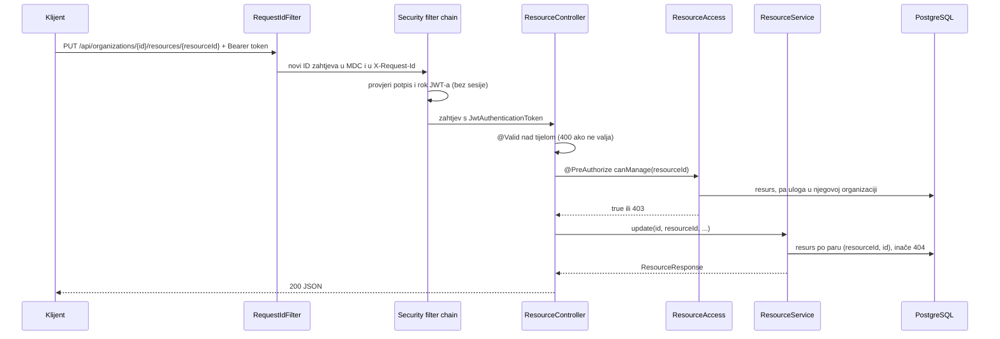
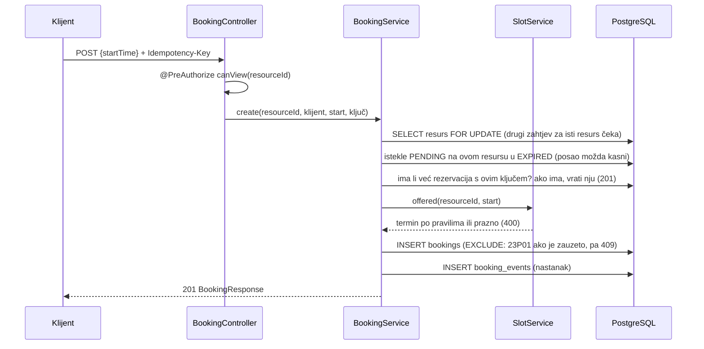

# Arhitektura

Opis backenda i frontenda kakvi su 26.11.2026, sa šemom do migracije V47. V46 i V47 nisu nove tabele, nego ispravke indeksa iz pregleda koda (`docs/ODLUKE.md`).

## Paketi i slojevi

Backend je jedna Spring Boot aplikacija. Paketi su po funkcionalnosti, ne po sloju: `auth`, `user`, `organization`, `resource`, `availability`, `booking`, `notification`, `stats`, a uz njih `error` (Problem Details), `config` (security, sat, JWT, Swagger), `paging` (oblik stranice), `storage` (gdje se čuvaju slike), `observability` (ID zahtjeva u logu) i `status`. Kasnije su došli `audit` (dnevnik osjetljivih radnji), `ratelimit` (granica pokušaja prijave), `export` i `account` (izvoz i brisanje naloga), `payment` (Stripe), `screen` (ekran na vratima) i `demo` (podaci za demo profil). Lista čekanja, serije i iCal pretplata su u `booking`, pozivni linkovi u `organization`, a push pretplate u `notification`, jer su push i mail dva kanala istog outboxa.

Unutar paketa je uvijek isti red: kontroler prima zahtjev i provjerava pristup, servis drži pravila i transakciju, repozitorij priča s bazom. Kontroler vraća samo DTO (`record`), nikad entitet. Repozitorij organizacija je vidljiv samo u paketu `organization`, pa paket `resource` do organizacije dolazi preko `OrganizationService`. Isto važi za rezervacije: `BookingRepository` vidi samo paket `booking`.

Zavisnosti idu u jednom smjeru: `booking` zna za `availability` (koji termini se nude), a `availability` ne zna za rezervacije. Zato je `GET /api/resources/{id}/slots` u paketu `booking`: `FreeSlotService` uzme ponuđene termine iz `SlotService` i podijeli ih na slobodne i zauzete. Paket `stats` samo čita: rezervacije broji vlastitim upitima u `StatsRepository` (`Repository<Booking, UUID>`, bez `save` i `delete`), a ponuđene minute za popunjenost uzima iz `SlotService`, da kalendar i statistika imaju istu definiciju radnog vremena. Za `stats` ne zna niko.

## Tok jednog zahtjeva

Primjer: trener mijenja svoj resurs.

Token nosi samo ID korisnika. Uloga se čita iz baze kod svakog zahtjeva, pa oduzeta uloga važi odmah. Svaka greška, i ona iz filtera, prolazi kroz `GlobalExceptionHandler` i vraća se kao `application/problem+json`.

Rute s organizacijom u putanji (`/api/organizations/{id}/...`) provjerava `OrganizationAccess`. Rute bez nje (`/api/resources/{resourceId}`) provjerava `ResourceAccess`, koji organizaciju uzima iz resursa, a rute `/api/bookings/{bookingId}/...` provjerava `BookingAccess`, koji resurs uzima iz rezervacije. `GET /api/me/organizations` nema ID u putanji i nema `@PreAuthorize`: upit gleda samo korisnika iz tokena, pa tuđe organizacije ne mogu ući u listu.

## Tok rezervacije

`POST /api/resources/{resourceId}/bookings` je mjesto gdje se sudaraju istovremeni zahtjevi, pa je redoslijed bitan.

Preklapanje čuva `EXCLUDE` constraint u bazi, a lock resursa postoji da drugi zahtjev dobije čist `409` umjesto deadlocka. Promjene statusa (`/confirm`, `/reject`, `/cancel`, `/check-in`, `/check-in/qr`, `/no-show`) idu kroz `Booking.prijedi`, koji zna tabelu dozvoljenih prelaza, a istovremenu izmjenu iste rezervacije hvata `@Version`. Zašto je tako, piše u [ODLUKE.md](ODLUKE.md).

## Model podataka

```mermaid
erDiagram
    users ||--o{ refresh_tokens : "ima"
    users ||--o{ organization_members : "član je"
    organizations ||--o{ organization_members : "ima članove"
    organizations ||--o{ organization_invites : "šalje"
    organization_members ||--o{ resources : "vodi (provider)"
    resources ||--o{ availability_rules : "radno vrijeme"
    resources ||--o{ time_off : "izuzeci"
    resources ||--o{ bookings : "rezervacije"
    users ||--o{ bookings : "klijent"
    bookings ||--o{ booking_events : "historija"
    users ||--o{ booking_events : "promijenio"
    users ||--o{ notifications : "prima"
    users ||--o{ user_tokens : "linkovi iz maila"
    bookings ||--o{ notifications : "o čemu"
    organization_invites ||--o| notifications : "mail pozivnice"
    organizations ||--o{ audit_log : "dnevnik"
    users ||--o{ audit_log : "uradio"
    resources ||--o{ waitlist_entries : "lista čekanja"
    users ||--o{ waitlist_entries : "čeka"
    users ||--o| calendar_feeds : "iCal link"
    bookings ||--o{ payments : "uplate"
    organizations ||--o{ invite_links : "pozivni linkovi"
    organizations ||--o{ door_screens : "ekrani"
    resources |o--o{ door_screens : "jedan resurs ili cijela organizacija"
    users ||--o{ push_subscriptions : "browseri"
    push_subscriptions ||--o{ notifications : "push kanal"

    users {
        uuid id PK
        varchar email UK "malim slovima, CHECK"
        varchar password_hash
        varchar display_name
        timestamptz created_at
        timestamptz email_verified_at
        timestamptz deleted_at "CHECK: obrisan red je anoniman"
    }
    user_tokens {
        uuid id PK
        uuid user_id FK
        varchar type "EMAIL_VERIFY, PASSWORD_RESET"
        varchar token_hash UK "SHA-256, ne token"
        timestamptz expires_at
        timestamptz used_at
    }
    refresh_tokens {
        uuid id PK
        uuid user_id FK
        uuid family_id "tokeni jedne prijave"
        varchar token_hash UK "SHA-256"
        timestamptz expires_at
        timestamptz revoked_at
        uuid replaced_by FK
    }
    organizations {
        uuid id PK
        varchar name
        varchar slug UK "CHECK formata"
        varchar timezone "IANA zona"
        timestamptz created_at
        int no_show_limit "nedolasci, sva tri ili nijedno"
        int no_show_window_days
        int no_show_block_days
    }
    organization_members {
        uuid organization_id PK
        uuid user_id PK
        varchar role "ADMIN, PROVIDER, CLIENT"
        timestamptz joined_at
    }
    organization_invites {
        uuid id PK
        uuid organization_id FK
        varchar email
        varchar role
        varchar token_hash UK
        timestamptz expires_at
        timestamptz accepted_at "jedna otvorena po emailu"
    }
    resources {
        uuid id PK
        uuid organization_id FK
        uuid provider_id FK "(organization_id, provider_id) u organization_members"
        varchar name
        varchar description
        int slot_minutes "5 do 480"
        boolean active
        timestamptz created_at
        varchar image_key "ključ u skladištu, ne slika"
        boolean auto_confirm "false: rezervacija čeka potvrdu"
        int cancel_notice_hours "rok za otkazivanje, 0 do 168"
        int capacity "mjesta u terminu, 1 do 100"
        int price_cents "u feninzima, 0 je besplatno"
        int max_active_per_member "pravila samo za klijente"
        int max_days_ahead
        int min_notice_minutes
    }
    availability_rules {
        uuid id PK
        uuid resource_id FK
        int day_of_week "1 ponedjeljak do 7 nedjelja"
        time start_time "lokalno u zoni organizacije"
        time end_time "EXCLUDE: bez preklapanja istog dana"
    }
    time_off {
        uuid id PK
        uuid resource_id FK
        timestamptz starts_at "trenutak, ne lokalno vrijeme"
        timestamptz ends_at "CHECK: poslije početka"
        varchar reason "samo za admina i providera"
        timestamptz created_at
    }
    bookings {
        uuid id PK
        uuid resource_id FK "EXCLUDE: isto mjesto se ne preklapa"
        uuid client_id FK "EXCLUDE: jedna osoba, jedno mjesto u terminu"
        int seat "1 do kapaciteta, bira Java pod lockom"
        timestamptz start_time
        timestamptz end_time "CHECK: poslije početka"
        varchar status "PENDING i CONFIRMED drže termin"
        timestamptz created_at
        varchar idempotency_key "UNIQUE s client_id"
        bigint version "@Version"
        uuid series_id "ista serija, bez FK"
        int price_cents "cijena u trenutku rezervacije"
    }
    notifications {
        uuid id PK
        uuid user_id FK "prazno samo za pozivnicu"
        varchar email "samo za pozivnicu"
        uuid invite_id FK "ON DELETE SET NULL"
        varchar type "BOOKING_CONFIRMED..."
        uuid booking_id FK
        varchar status "PENDING, SENT, FAILED"
        int attempts
        timestamptz next_attempt_at
        timestamptz created_at
        timestamptz sent_at
        varchar subject "tekst nastaje s obavijesti"
        text body
        text ics "prilog uz potvrdu"
        varchar last_error
        varchar channel "EMAIL ili PUSH"
        uuid push_subscription_id FK "ON DELETE CASCADE"
    }
    audit_log {
        bigint id PK "redni broj, daje redoslijed"
        uuid organization_id FK
        uuid actor_id FK "ON DELETE SET NULL"
        varchar action "CHECK: ORGANIZATION_CREATED... ACCOUNT_DELETED"
        uuid target_id "bez FK, zapis ostaje"
        varchar detail "uloga ili naziv resursa"
        timestamptz created_at
    }
    login_failures {
        varchar email PK "iz zahtjeva, bez FK na users"
        int failures
        timestamptz window_start
        timestamptz locked_until
    }
    waitlist_entries {
        uuid id PK
        uuid resource_id FK
        uuid client_id FK
        timestamptz start_time
        timestamptz end_time
        varchar status "WAITING, OFFERED, BOOKED, EXPIRED, CANCELLED"
        timestamptz offered_until "CHECK: ponuda ima rok"
    }
    calendar_feeds {
        uuid user_id PK
        varchar token_hash UK
        timestamptz created_at
    }
    payments {
        uuid id PK
        uuid booking_id FK
        int amount_cents
        varchar currency
        varchar status "OPEN, PAID, EXPIRED, REFUNDED"
        varchar stripe_session_id UK
        varchar stripe_payment_intent_id "kad je novac uplaćen"
        timestamptz expires_at
    }
    invite_links {
        uuid id PK
        uuid organization_id FK
        varchar role "CHECK: samo CLIENT"
        varchar token_hash UK
        int max_uses
        int uses "CHECK: ne preko max_uses"
        timestamptz expires_at
        timestamptz revoked_at
        uuid created_by FK "ON DELETE SET NULL"
    }
    door_screens {
        uuid id PK
        uuid organization_id FK
        uuid resource_id FK "(resource_id, organization_id): resurs iste organizacije"
        varchar token_hash UK
        timestamptz revoked_at
        uuid created_by FK
    }
    push_subscriptions {
        uuid id PK
        uuid user_id FK
        varchar endpoint UK "adresa push servisa"
        varchar p256dh
        varchar auth
        varchar device
    }
    booking_events {
        uuid id PK
        uuid booking_id FK
        varchar from_status "prazno kod nastanka"
        varchar to_status
        uuid actor_id FK "prazno kad je promjena automatska"
        timestamptz created_at
    }
```

Resurs ne pokazuje na `users` direktno, nego na par (organizacija, korisnik) u `organization_members`. Tako provider ne može biti neko izvan organizacije resursa, ni kad je Java kod pogrešan. Sva vremena su `TIMESTAMPTZ`, a ID-jevi UUID. Zašto je tako, piše u [ODLUKE.md](ODLUKE.md).

## Slobodni termini

Slobodni termini nisu tabela. `GET /api/resources/{resourceId}/slots?from=&to=` ide kroz `FreeSlotService`, koji prvo pita `SlotService`, koji iz baze učita resurs sa zonom organizacije, sedmična pravila i izuzetke koji dodiruju traženi period. Onda sve to preda klasi `SlotCalculator`, koja nema ni Spring ni bazu i samo računa. Trenutno vrijeme dolazi iz `Clock` beana, pa se termini koji su već počeli ne nude. Na kraju `FreeSlotService` termine koje drži `PENDING` ili `CONFIRMED` rezervacija prebaci u listu `taken`, a uz svoju rezervaciju korisnik dobije i njen status.

## Slike i šta dolazi

Slika resursa ide kroz interface `StorageService`. Implementacije su `LocalStorageService` (folder na disku) i `S3StorageService` (S3-kompatibilno skladište, predviđeno za Cloudflare R2), a bira se preko `slotbook.storage.type`. Na produkciji je zasad disk, zašto je u [ODLUKE.md](ODLUKE.md). Pozadinski posao `BookingJob` (`@Scheduled`, svake minute) prebacuje istekle `PENDING` rezervacije u `EXPIRED` i zatvara potvrđene dan poslije kraja. Oba prelaza su po jedna SQL naredba koja mijenja status i piše historiju bez aktera. Isti posao upisuje podsjetnike za potvrđene termine u sljedećih 24 sata. Obavijesti idu kroz tabelu `notifications` (outbox): `BookingService` je upiše preko `NotificationService` u istoj transakciji kao promjenu rezervacije, a `NotificationJob` ih svakih 30 sekundi šalje kroz `NotificationSender`, jednu po jednu, svaku u svojoj transakciji (`FOR UPDATE SKIP LOCKED`). Tekst emaila (`subject`, `body`) se upiše kad obavijest nastane, pa pošiljalac ne zna ništa o rezervacijama. Paket `booking` zna za `notification`, a obrnuto ne, zato obavijest drži samo `booking_id`. Za ponudu s liste čekanja, potvrdu, odbijanje i podsjetnik uz mail nastaje i po jedan red s kanalom `PUSH` za svaki browser korisnika. Šalje ih isti posao, s istim ponovnim pokušajima.

## Frontend

`frontend/` je React s Viteom, u JavaScriptu. Paketi su opet po funkcionalnosti (`kalendar`, `rezervacije`, `clanovi`, `nalog`...). Backend zovu samo funkcije iz `src/api/`, preko jednog `apiFetch`, koji drži access token u memoriji, na `401` jednom obnovi sesiju (i kad tri zahtjeva padnu u isto vrijeme) i svaku grešku pretvori u `ApiError` s Problem Details tijelom. Stanje sa servera drži TanStack Query, a sesiju `SesijaProvider`. Vrijeme se prikazuje u zoni organizacije, kroz `src/vrijeme/`. Boje, fontovi i razmaci su samo u `src/tokeni.css`, a test pada ako se u kodu pojavi boja ili veličina fonta van tokena. U buildu je i service worker (`src/sw.js`) koji čuva samo statiku i prima push, a `/api` ne dira. Na Vercelu `vercel.json` prosljeđuje `/api` na Render, pa su frontend i backend za browser isti origin.
