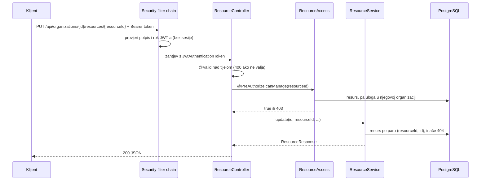
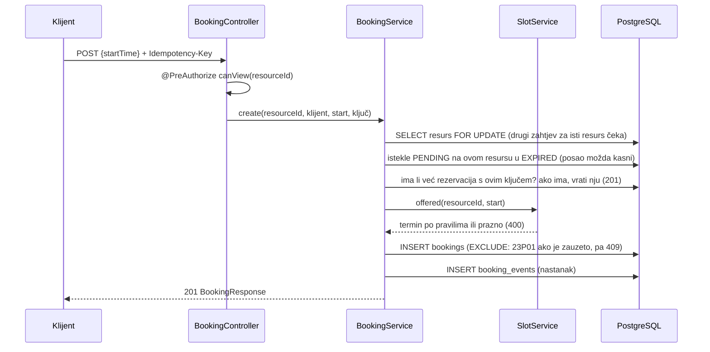
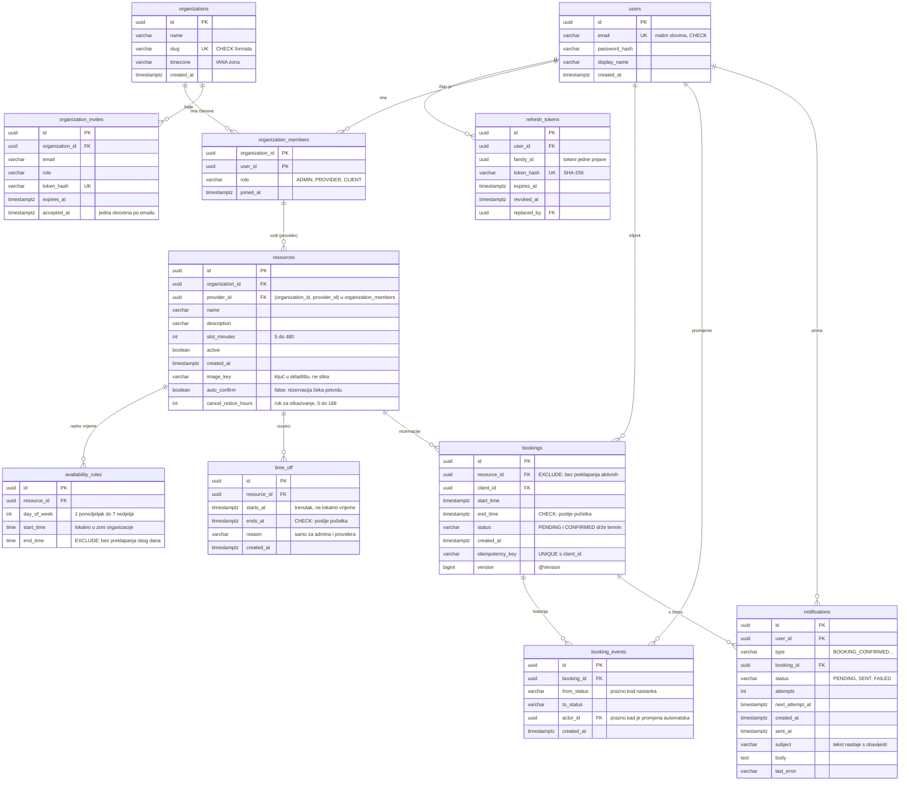

# Arhitektura

Opis onoga što postoji sada (Faze 1 do 4). Obavijesti i frontend još ne postoje, pa ih ovdje nema.

## Paketi i slojevi

Backend je jedna Spring Boot aplikacija. Paketi su po funkcionalnosti, ne po sloju: `auth`, `user`, `organization`, `resource`, `availability`, `booking`, `notification`, a uz njih `error` (Problem Details), `config` (security, sat, JWT, Swagger), `paging` (oblik stranice), `storage` (gdje se čuvaju slike) i `status`.

Unutar paketa je uvijek isti red: kontroler prima zahtjev i provjerava pristup, servis drži pravila i transakciju, repozitorij priča s bazom. Kontroler vraća samo DTO (`record`), nikad entitet. Repozitorij organizacija je vidljiv samo u paketu `organization`, pa paket `resource` do organizacije dolazi preko `OrganizationService`. Isto važi za rezervacije: `BookingRepository` vidi samo paket `booking`.

Zavisnosti idu u jednom smjeru: `booking` zna za `availability` (koji termini se nude), a `availability` ne zna za rezervacije. Zato je `GET /api/resources/{id}/slots` u paketu `booking`: `FreeSlotService` uzme ponuđene termine iz `SlotService` i izbaci zauzete.

## Tok jednog zahtjeva

Primjer: trener mijenja svoj resurs.

Token nosi samo ID korisnika. Uloga se čita iz baze kod svakog zahtjeva, pa oduzeta uloga važi odmah. Svaka greška, i ona iz filtera, prolazi kroz `GlobalExceptionHandler` i vraća se kao `application/problem+json`.

Rute s organizacijom u putanji (`/api/organizations/{id}/...`) provjerava `OrganizationAccess`. Rute bez nje (`/api/resources/{resourceId}`) provjerava `ResourceAccess`, koji organizaciju uzima iz resursa, a rute `/api/bookings/{bookingId}/...` provjerava `BookingAccess`, koji resurs uzima iz rezervacije.

## Tok rezervacije

`POST /api/resources/{resourceId}/bookings` je mjesto gdje se sudaraju istovremeni zahtjevi, pa je redoslijed bitan.

Preklapanje čuva `EXCLUDE` constraint u bazi, a lock resursa postoji da drugi zahtjev dobije čist `409` umjesto deadlocka. Promjene statusa (`/confirm`, `/reject`, `/cancel`, `/check-in`, `/no-show`) idu kroz `Booking.prijedi`, koji zna tabelu dozvoljenih prelaza, a istovremenu izmjenu iste rezervacije hvata `@Version`. Zašto je tako, piše u [ODLUKE.md](ODLUKE.md).

## Model podataka

Resurs ne pokazuje na `users` direktno, nego na par (organizacija, korisnik) u `organization_members`. Tako provider ne može biti neko izvan organizacije resursa, ni kad je Java kod pogrešan. Sva vremena su `TIMESTAMPTZ`, a ID-jevi UUID. Zašto je tako, piše u [ODLUKE.md](ODLUKE.md).

## Slobodni termini

Slobodni termini nisu tabela. `GET /api/resources/{resourceId}/slots?from=&to=` ide kroz `FreeSlotService`, koji prvo pita `SlotService`, koji iz baze učita resurs sa zonom organizacije, sedmična pravila i izuzetke koji dodiruju traženi period. Onda sve to preda klasi `SlotCalculator`, koja nema ni Spring ni bazu i samo računa. Trenutno vrijeme dolazi iz `Clock` beana, pa se termini koji su već počeli ne nude. Na kraju `FreeSlotService` izbaci termine koje drži `PENDING` ili `CONFIRMED` rezervacija.

## Slike i šta dolazi

Slika resursa ide kroz interface `StorageService`. Implementacije su `LocalStorageService` (folder na disku) i `S3StorageService` (S3-kompatibilno skladište, Cloudflare R2 na produkciji), a bira se preko `slotbook.storage.type`. Pozadinski posao `BookingJob` (`@Scheduled`, svake minute) prebacuje istekle `PENDING` rezervacije u `EXPIRED` i zatvara potvrđene dan poslije kraja. Oba prelaza su po jedna SQL naredba koja mijenja status i piše historiju bez aktera. Obavijesti idu kroz tabelu `notifications` (outbox): `BookingService` je upiše preko `NotificationService` u istoj transakciji kao promjenu rezervacije, a `NotificationJob` ih svakih 30 sekundi šalje kroz `NotificationSender`, jednu po jednu, svaku u svojoj transakciji (`FOR UPDATE SKIP LOCKED`). Tekst emaila (`subject`, `body`) se upiše kad obavijest nastane, pa pošiljalac ne zna ništa o rezervacijama. Paket `booking` zna za `notification`, a obrnuto ne, zato obavijest drži samo `booking_id`.
