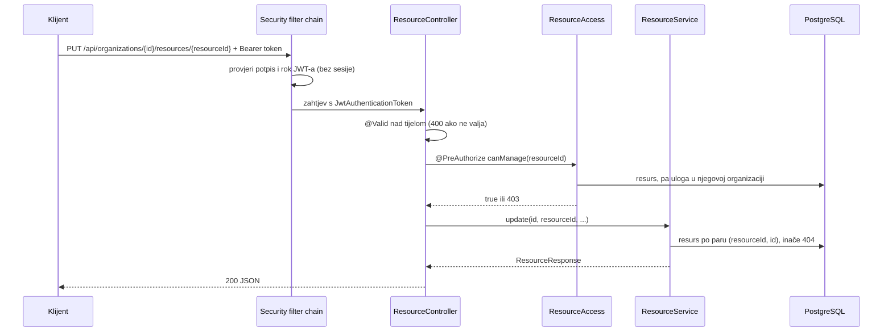
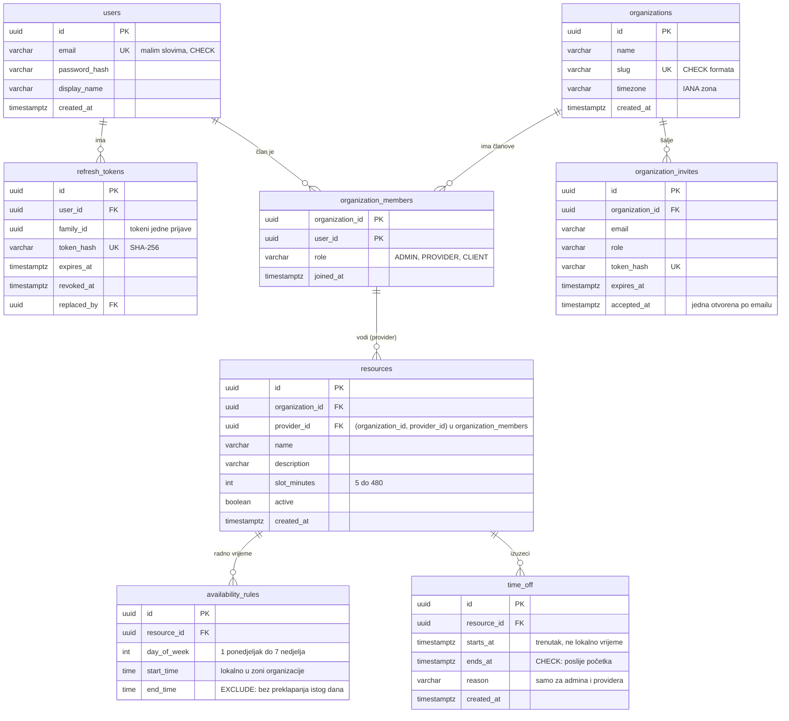

# Arhitektura

Opis onoga što postoji sada (Faza 3 u izradi). Rezervacije, obavijesti i frontend još ne postoje, pa ih ovdje nema.

## Paketi i slojevi

Backend je jedna Spring Boot aplikacija. Paketi su po funkcionalnosti, ne po sloju: `auth`, `user`, `organization`, `resource`, `availability`, a uz njih `error` (Problem Details), `config` (security, sat, JWT, Swagger), `paging` (oblik stranice) i `status`.

Unutar paketa je uvijek isti red: kontroler prima zahtjev i provjerava pristup, servis drži pravila i transakciju, repozitorij priča s bazom. Kontroler vraća samo DTO (`record`), nikad entitet. Repozitorij organizacija je vidljiv samo u paketu `organization`, pa paket `resource` do organizacije dolazi preko `OrganizationService`.

## Tok jednog zahtjeva

Primjer: trener mijenja svoj resurs.

Token nosi samo ID korisnika. Uloga se čita iz baze kod svakog zahtjeva, pa oduzeta uloga važi odmah. Svaka greška, i ona iz filtera, prolazi kroz `GlobalExceptionHandler` i vraća se kao `application/problem+json`.

Rute s organizacijom u putanji (`/api/organizations/{id}/...`) provjerava `OrganizationAccess`. Rute bez nje (`/api/resources/{resourceId}`) provjerava `ResourceAccess`, koji organizaciju uzima iz resursa.

## Model podataka

Resurs ne pokazuje na `users` direktno, nego na par (organizacija, korisnik) u `organization_members`. Tako provider ne može biti neko izvan organizacije resursa, ni kad je Java kod pogrešan. Sva vremena su `TIMESTAMPTZ`, a ID-jevi UUID. Zašto je tako, piše u [ODLUKE.md](ODLUKE.md).

## Slobodni termini

Slobodni termini nisu tabela. `GET /api/resources/{resourceId}/slots?from=&to=` ide kroz `SlotService`, koji iz baze učita resurs sa zonom organizacije, sedmična pravila i izuzetke koji dodiruju traženi period. Onda sve to preda klasi `SlotCalculator`, koja nema ni Spring ni bazu i samo računa. Trenutno vrijeme dolazi iz `Clock` beana, pa se termini koji su već počeli ne nude.

## Šta dolazi

U ostatku Faze 3 dolazi slika resursa kroz `StorageService`. U Fazi 4 dolazi `bookings` s `EXCLUDE` constraintom, i tada se od slobodnih termina oduzimaju i rezervacije.
