# Historija po fazama

Šta je urađeno u kojoj fazi, redom kako je nastajalo. Plan i kriteriji "gotovo" su u [PROJECT_PLAN.md](../PROJECT_PLAN.md), a zašto je nešto urađeno baš tako u [ODLUKE.md](ODLUKE.md).

Tekst opisuje stanje na kraju svake faze. Kad se nešto kasnije promijenilo, to piše uz tu fazu. Za faze 2, 3, 4 i 6 tada nisam provjeravao da li Render već vrti novu verziju. Od Faze 12 je na produkciji sve što je na `main`.

| Faza | Šta | Status |
|---|---|---|
| 1 | Temelji i infrastruktura | gotovo |
| 2 | Auth i organizacije | gotovo |
| 3 | Resursi i dostupnost, slobodni termini | gotovo |
| 4 | Rezervacije i konkurentnost | gotovo |
| 5 | Pozadinski poslovi i email obavijesti | gotovo |
| 6 | Statistika | gotovo |
| 7 | Frontend (jezgro) | gotovo |
| 8 | Sigurnost i GDPR | gotovo |
| 9 | Observability i performanse | gotovo |
| 10 | Napredne funkcije (lista čekanja, iCal, SSE...) | gotovo |
| 11 | Plaćanje (Stripe, test mode) | gotovo |
| 12 | Deploy i prezentacija | gotovo |
| 13 | Završni pregled i dodaci | gotovo |
| 14 | AI asistent za rezervacije | nije počelo |

## Faza 1: temelji

Spring Boot projekat, PostgreSQL i Mailpit u Docker Composeu, `GET /api/status`, Swagger UI, `Dockerfile` i profil `prod`. Greške idu u formatu Problem Details, s porukama na bosanskom. CI na GitHub Actions radi build, testove, pokrivenost i skeniranje tajni.

Prva Flyway migracija uključuje `btree_gist`. Prije nego što sam išta gradio na tome, provjerio sam da ekstenzija radi na Neon-u (PostgreSQL 17.11), pa je `EXCLUDE` constraint ostao plan za zaštitu od preklapanja. Na kraju faze backend je bio na Renderu (free plan), s bazom na Neon-u, i `GET /api/status` je odgovarao.

## Faza 2: auth i organizacije

Registracija (`POST /api/auth/register`), prijava s JWT access tokenom (`POST /api/auth/login`) i `GET /api/me`. Refresh token je u httpOnly kolačiću, s rotacijom i detekcijom ponovne upotrebe (`/api/auth/refresh`, `/api/auth/logout`). Od Faze 8 registracija uvijek vraća `202` bez tijela.

Ko napravi organizaciju (`POST /api/organizations`), postaje njen `ADMIN`. Javni profil organizacije se vidi i bez prijave (`GET /api/organizations/{slug}`). Admin vidi članove s ulogama (`GET /api/organizations/{id}/members`), a klijent iste organizacije i admin neke druge dobiju `403`. Uloga se čita iz baze kod svakog zahtjeva, preko `@PreAuthorize`.

Admin poziva osobu s ulogom (`POST /api/organizations/{id}/invites`). Pozivnica stiže mailom, s linkom koji važi 7 dana i koji admin ne vidi. Osoba postaje član kad je prihvati prijavljena s istim emailom (`POST /api/invites/accept`).

Izolaciju organizacija dokazuje test u kojem admin jedne organizacije na svakom endpointu druge dobije `403` i ništa se ne promijeni. Test padne i kad se pojavi novi endpoint nad organizacijom koji nije u njemu.

## Faza 3: resursi i dostupnost

Admin ili provider organizacije pravi resurs, npr. salu ili termin konsultacija, s trajanjem termina (`POST /api/organizations/{id}/resources`). Provider resursa je onaj ko ga napravi, a baza ne pušta da to bude neko izvan organizacije. Članovi vide resurse po stranicama (`?page=0&size=20`, najviše 100), i lista članova od tada isto ide po stranicama.

Admin mijenja svaki resurs, provider samo svoje (`PUT .../resources/{resourceId}`). Resurs se ne briše nego deaktivira (`DELETE` na istoj adresi), i klijent ga onda ne vidi. Admin ga može prebaciti na drugog providera ili admina (`PUT .../resources/{resourceId}/provider`). Kod `GET /api/resources/{resourceId}` organizacija za provjeru pristupa se uzima iz samog resursa.

Sedmično radno vrijeme se postavlja odjednom za cijelu sedmicu (`PUT /api/resources/{resourceId}/availability`), u lokalnom vremenu zone organizacije. Intervali istog dana se ne smiju preklapati, i to čuva baza. Godišnji ili praznik je izuzetak s tačnim periodom i zonom (`/api/resources/{resourceId}/time-off`), a vide ga samo admin i provider.

Slobodni termini se računaju iz radnog vremena i izuzetaka za najviše 31 dan (`GET /api/resources/{resourceId}/slots?from=2035-03-19&to=2035-03-27`), u zoni organizacije i ispravno preko prelaska na ljetno vrijeme. Od Faze 4 se od njih oduzimaju zauzeti termini. Od Faze 7 isti odgovor ima i listu zauzetih (`taken`), u kojoj korisnik vidi koji su njegovi i da li čekaju potvrdu.

Slika resursa je JPEG, PNG ili WebP do 2 MB (`POST /api/resources/{resourceId}/image`), a vidi je svako ko vidi resurs. Čuva se na disku ili u S3-kompatibilnom skladištu (`STORAGE_TYPE=s3`). Na Renderu je i danas disk, jer R2 nisam uključio (vidi Fazu 12), pa slike ne prežive deploy.

## Faza 4: rezervacije i konkurentnost

Član rezerviše termin koji kalendar nudi (`POST /api/resources/{resourceId}/bookings`) i šalje samo početak, jer kraj određuje trajanje termina na resursu. Dvije aktivne rezervacije istog resursa se ne mogu preklopiti, i to čuva baza (`EXCLUDE` constraint). Test šalje 20 istovremenih zahtjeva za isti termin kroz pravi HTTP server, u četiri runde. U svakoj prođe tačno jedan, a ostalih 19 dobije `409`. Na putu do toga sam naletio na deadlock u Postgresu, opisan u [ODLUKE.md](ODLUKE.md).

Ponovljen zahtjev s istim `Idempotency-Key` vraća istu rezervaciju, a isti ključ za drugi termin daje `422`.

Resurs je na automatskoj ili ručnoj potvrdi. Admin ili provider potvrđuje, odbija i označava dolazak ili nedolazak, a klijent otkazuje svoju rezervaciju do roka koji piše na resursu (`POST /api/bookings/{id}/confirm`, `/reject`, `/cancel`, `/check-in`, `/no-show`). Nedozvoljen prelaz, npr. potvrda otkazane rezervacije, vraća `409`. Svaka promjena statusa ide u historiju (`GET /api/bookings/{id}/events`).

Korisnik vidi svoje rezervacije iz svih organizacija (`GET /api/bookings/mine`), od Faze 7 s nazivom organizacije i rokom za otkazivanje. Admin i provider resursa vide raspored s imenima klijenata (`GET /api/resources/{resourceId}/bookings?from&to`), a klijent dobije `403`.

## Faza 5: pozadinski poslovi i mailovi

Rezervacija na ručnoj potvrdi čeka providera 24 sata, a najduže do početka termina. Posao svake minute prebaci isteklu u `EXPIRED` i oslobodi termin. Potvrđenu zatvori (`COMPLETED`) dan poslije kraja, da provider stigne označiti nedolazak. Dan prije potvrđenog termina klijent dobije podsjetnik, ako je rezervisao bar dan unaprijed. Kad posao kasni, nova rezervacija na istom resursu sama oslobodi istekle.

Svaka promjena koju neko treba saznati (nova rezervacija na čekanju, potvrda, odbijanje, otkazivanje, istek) upisuje obavijest u tabelu `notifications`, u istoj transakciji kao i sama promjena. Drugi posao svakih 30 sekundi šalje te obavijesti mailom. Kad SMTP ne odgovara, pokušava ponovo poslije 1, 5, 25 i 125 minuta, a poslije petog neuspjeha odustane i zapiše razlog. Uz potvrdu ide prilog `termin.ics`, koji se otvori u kalendaru. Test šalje potvrdu kroz pravi SMTP u Mailpit i provjerava naslov, tekst sa č, vrijeme u zoni organizacije i prilog.

Na kraju faze SMTP na Renderu nije bio podešen, pa su obavijesti tamo završavale kao `FAILED`. Od Faze 12 mail šalje Brevo.

Poslovi nemaju ShedLock, jer su sigurni i kad rade na dvije instance odjednom. Test pokrene dva posla isteka tako da drugi stvarno čeka na lock prvog, i svaka rezervacija istekne jednom. Kod podsjetnika drugi padne na unique indeksu, pa ostane jedan podsjetnik. Kod slanja drugi preskoči obavijest koju prvi upravo šalje (`SKIP LOCKED`). Jedan test šalje potvrdu dok je Mailpit pauziran: rezervacija nastane, prvi pokušaj padne na timeoutu, drugi stigne u Mailpit.

U istoj fazi su došli potvrda emaila i reset lozinke. Link za potvrdu važi 24 sata i radi jednom (`POST /api/auth/verify-email`, token u tijelu). Novi se traži bez prijave (`POST /api/auth/email-verification`, uvijek `204`), a `GET /api/me` kaže da li je email potvrđen. Baza čuva samo hash tokena, a tijelo maila se briše čim ode. Od Faze 8 nalog s nepotvrđenim emailom se ne može prijaviti i dobije isti `401` kao za pogrešnu lozinku. Link vodi na stranicu frontenda (`APP_URL`), koja je napravljena tek u koraku 10 Faze 8.

Ko zaboravi lozinku, traži link na `POST /api/auth/password-reset`. Odgovor je isti i za email bez naloga, da se ne može provjeriti ko je registrovan. Link važi sat vremena. Nova lozinka se postavlja na `POST /api/auth/password-reset/confirm` i poništava starije linkove za reset i sve sesije na svim uređajima. `GET /api/me/organizations` (od Faze 7) vraća organizacije korisnika s ulogom u svakoj.

## Faza 6: statistika

Admin i provider vide statistiku za period do godinu dana (`GET /api/organizations/{id}/stats?from=2035-11-01&to=2035-12-01`, datumi u zoni organizacije, `to` se ne uključuje). Statistika ima broj rezervacija po statusu, najtraženije termine po danu i satu, i popunjenost svakog resursa kao zauzete i ponuđene minute. Admin vidi cijelu organizaciju, provider samo svoje resurse, a klijent dobije `403`. Sa zaglavljem `Accept: text/csv` isti endpoint vraća popunjenost kao CSV za Excel.

Period se gleda po početku termina, a dan i sat po lokalnom vremenu, pa srijeda u 9 ostaje srijeda u 9 i poslije prelaska na zimsko vrijeme. Ponuđene minute računa isti kod koji pravi kalendar. Radno vrijeme nema historiju, pa se i prošli period računa po sadašnjem radnom vremenu.

Kriterij faze je test koji upiše mjesec rezervacija u čitaonici i poredi cijeli JSON s brojkama koje sam izračunao ručno. Indeks za statistiku sam izmjerio na 408 hiljada rezervacija. Za jedan mjesec upit je pao s oko 20 na oko 2 ms, a za cijelu godinu se nije promijenio. Brojke su u [PERFORMANSE.md](PERFORMANSE.md).

## Faza 7: frontend

Prijava, registracija i obnova sesije, s jednim refreshom za više paralelnih zahtjeva. Lista organizacija s formom za novu, kalendar slobodnih termina po danima i rezervacija iz kalendara. Moje rezervacije s otkazivanjem i QR kodom za dolazak. Raspored za onoga ko vodi termin (potvrdi, odbij, dolazak, nedolazak).

Za admina tu su lista članova s pozivnicom, stranica na koju vodi link iz pozivnice, resursi (novi, izmjena, deaktivacija, ko ga vodi) i sedmično radno vrijeme s izuzecima. Statistika ide po mjesecima (rezervacije po stanju, popunjenost po resursu, najtraženiji termini), s preuzimanjem CSV-a.

Glavni tok (prijava, rezervacija, otkazivanje i termin koji neko uzme prije potvrde) prolazi Playwright test kroz pravi backend i pravu bazu. Kasnije ih je bilo devet, nabrojani su u README-ju. Raspored providera, statistika i forme admina su provjereni samo s lažnim backendom u Vitest testovima i u browseru.

## Faza 8: sigurnost i GDPR

Prijava i registracija imaju granicu pokušaja po IP adresi (`429` s `Retry-After`). Reset lozinke, novi link za potvrdu i pozivnice imaju granicu od tri maila na sat istom primaocu. Poslije 5 pogrešnih lozinki za isti email prijava je zaključana 15 minuta. Registracija ne otkriva da li nalog postoji: uvijek vraća `202`, a prijava radi tek poslije potvrde emaila.

Backend šalje sigurnosna zaglavlja (CSP za `/api`, HSTS, `Referrer-Policy`), a CORS pušta samo adresu frontenda. Admin čita dnevnik osjetljivih radnji svoje organizacije (`GET /api/organizations/{id}/audit-log`). Korisnik može izvesti sve svoje podatke u JSON-u (`GET /api/me/export`) i obrisati nalog uz lozinku (`DELETE /api/me`). Brisanje je anonimizacija.

Sve to ima i frontend: ekran "pogledaj inbox" poslije registracije, stranicu za potvrdu emaila, poruku sa satom sljedećeg pokušaja kod `429` i stranicu `/nalog` s izvozom i brisanjem. CI je dobio CodeQL za Javu i JavaScript i provjeru zavisnosti.

Test pristupa proba svaki endpoint nad podacima organizacije s tokenom admina druge organizacije, klijenta, providera drugog resursa iz iste organizacije i bez tokena. Prolaz kroz OWASP Top 10 je u [SIGURNOST.md](SIGURNOST.md).

## Faza 9: observability i performanse

Svaki zahtjev dobije ID (`X-Request-Id`), koji je u svakoj liniji loga i u tijelu greške `500`. Na produkciji je log u JSON-u. `/actuator/health/readiness` gleda i bazu, a liveness ne gleda, da restart ne pokušava popraviti bazu koja se upravo budi. Tri Micrometer brojača broje upisane rezervacije, sudare (`409`) i neuspjele pokušaje slanja maila. Test s 20 niti provjerava i njih: 4 nove rezervacije i 76 sudara. ERROR linije idu u Sentry s ID-jem zahtjeva kao tagom, ali samo kad postoji `SENTRY_DSN`, pa testovi i lokalni rad idu bez njega.

Za sedam glavnih lista test mjeri broj SQL upita s jednim i sa šest redova i traži isti broj. N+1 nije nađen. `EXPLAIN` na 408 hiljada rezervacija je pokazao da raspored providera čita svu historiju stola, 1 861 red da bi vratio 33. Poslije donje granice i `CHECK`-a da rezervacija traje najviše 8 sati (`V33`) čita samo tih 33.

k6 je na laptopu tri puta po minutu opterećivao kalendar (50 zahtjeva u sekundi), rezervacije (10 u sekundi) i 20 članova na istom terminu. p95 je bio ispod 105 ms za kalendar i rezervacije i nijedan zahtjev nije pao. U sudaru je po terminu prošao tačno jedan od 20.

Backup je `pg_dump`. Vratio sam ga u praznu bazu, svih 15 tabela je imalo isti broj redova i aplikacija se nad njim podigla. Postupak je u [RUNBOOK.md](RUNBOOK.md). Backup Neona sam napravio i vratio 22.11.2026 (s jednom Neonovom zamkom, opisanom u RUNBOOK-u), a Sentry i Render health check sam podesio isti dan.

## Faza 10: napredne funkcije

Svaka je došla s testom i s UI-jem.

Na zauzet termin klijent se upiše na listu čekanja. Kad se termin oslobodi, posao ga ponudi prvom na listi na 30 minuta, i za to vrijeme ga niko drugi ne može uzeti.

Moje rezervacije se mogu pratiti u Google ili Apple kalendaru preko tajnog `.ics` linka. Otvoren kalendar u aplikaciji se sam osvježi preko SSE-a kad neko rezerviše ili otkaže.

Isti termin se može rezervisati svake sedmice do 12 puta, sve ili ništa. Sedmice se računaju u zoni organizacije, pa ljetno vrijeme ne pomjera sat.

Potvrđena rezervacija ima QR kod. Kod je HMAC nad rezervacijom, i dolazak preko njega upisuje samo onaj ko vodi resurs. QR kod nisam skenirao pravim telefonom, jer telefon ne može otvoriti `localhost`.

Resurs može imati više mjesta (grupni trening, grupna soba). Svaka rezervacija tada ima broj mjesta, a isti `EXCLUDE` constraint pazi da se isto mjesto ne preklopi. Test sa 20 niti na trening s 5 mjesta svaki put pusti tačno 5. Da broj mjesta nije veći od kapaciteta čuva samo Java pod lockom resursa, ne baza, i to je zapisano u [ODLUKE.md](ODLUKE.md).

## Faza 11: plaćanje

Plaćanje ide preko Stripea u test modu. Resurs ima cijenu, a rezervacija plaćenog termina čeka uplatu 30 minuta. `POST /api/bookings/{id}/pay` vraća adresu Stripe Checkout stranice, a Stripe poslije javi uplatu webhookom.

Webhook bez ispravnog potpisa se odbija. Isti događaj poslan dvaput ne potvrdi rezervaciju dvaput i ne vrati novac. To dokazuje i test s pet istih dostava u istom trenutku, koji je u prvoj verziji našao grešku: za ispravno plaćen termin novac je vraćen četiri puta. Uplata koja stigne za već isteklu ili otkazanu rezervaciju se vraća. Ako Stripe odbije povrat, ni otkazivanje ne prolazi.

U testovima je Stripe lažan, a pravi sandbox je otvorio sesiju za 15 KM. U frontendu rezervacija koja čeka uplatu ima dugme "Plati 15 KM", u kalendaru odmah poslije rezervacije i u Mojim rezervacijama. Kad se korisnik vrati sa Stripea, lista pita server dok potvrda ne stigne, najviše minutu. Raspored providera za takvu rezervaciju ne nudi "Potvrdi". Ekrane sam pogledao na 375 i 1280 px, ali s lažnim backendom.

Cijeli tok sam onda prošao lokalno s pravim sandboxom i Stripe CLI-jem. Uplata 15 KM karticom 4242 je preko pravog webhooka potvrdila rezervaciju, a otkazivanje je vratilo cijeli iznos (detalji u [ODLUKE.md](ODLUKE.md)). Na Renderu sam Stripe podesio 26.11.2026 i provjerio jednom test uplatom kroz pravu Checkout stranicu. Demo klijent je platio Salu 3 karticom `4242...`, webhook je rezervaciju prebacio u potvrđenu, a otkazivanje je vratilo novac.

## Faza 12: deploy i prezentacija

Faza je počela redizajnom frontenda, prije deploya, da screenshotovi pokažu konačan izgled. Prvi smjer se zvao "Čelik i žar": siva podloga kao lim, grafitni tekst i jedna topla boja koja uvijek znači "tvoje". Potpis aplikacije je bila karta za voz. Poslije rezervacije se odštampa karta s brojem rezervacije i žigom stanja, a Moje rezervacije su niz takvih karata. Backend i API nisu dirani. Prije i poslije, s brojkama i onim što nije urađeno, je u [redizajn/poslije.md](redizajn/poslije.md).

Taj redizajn je ispao ravan, pa sam ga istog dana zamijenio drugim, "Mjed i emajl". Termin je žeton na ploči, rezervacija je karta s mjedenom folijom koja se naginje za kursorom, svaki resurs ima svoju emajl boju, a aplikacija ima svijetlu i tamnu temu. Odjavljeni posjetilac prvo vidi landing na kojem može probati tri teška problema. Ni ovaj put backend nije diran, a svaki ekran je dobio svoj commit. Smjer je u [redizajn/smjer.md](redizajn/smjer.md), a pravila u [DIZAJN.md](DIZAJN.md).

Treći redizajn (25.11.) je zadržao materijal i stišao ostalo: jedan font (Hanken Grotesk), mirniji naslovi, mjed bez preliva na dugmadima. Landing sad za par sekundi kaže šta je SlotBook i za koga je, bez statusnih kodova i imena testova. Screenshotovi landinga su u [redizajn/redizajn-3/](redizajn/redizajn-3/).

Dan poslije (26.11.) promijenio sam samo paletu. Hladni porculan i teget noć su djelovali staro, pa je dan sad topli kamen, noć neutralan grafit, mjed je svjetlija, a ploče imaju tanku ivicu umjesto teških sjena. "Kako radi" je tamna traka u obje teme. Kontraste sam ponovo izračunao i upisao u [DIZAJN.md](DIZAJN.md), a hero u novoj paleti je u [redizajn/redizajn-4/](redizajn/redizajn-4/). Isti dan je tamna tema postala podrazumijevana (svijetla se bira u zaglavlju), slobodni termini su dobili mjedeni rub umjesto zelenog, a zauzeti katanac umjesto precrtanog vremena.

Popodne su došle sitnice sa spiska: meni s inicijalima na telefonu, put do ekrana iznad naslova, strelice i raspon sedmice u kalendaru, radnje na karti kao prava dugmad, kostur dok se landing učitava i slika za dijeljenje linka (`og.png`). Ekrani na 375 i 1280 px u obje teme su u [redizajn/redizajn-4/ekrani/](redizajn/redizajn-4/ekrani/).

Faza je zatvorena 26.11.2026. Na produkciji su podešeni Stripe (test mode), VAPID ključevi za push i UptimeRobot, koji svakih 5 minuta zove liveness, pa Render ne zaspi i posjetilac ne čeka hladni start. Dvije stvari iz plana nisu urađene. R2 traži karticu i za besplatni plan, pa su slike ostale na disku Rendera ([ODLUKE.md](ODLUKE.md)). Poddomen čeka vlastiti domen iz portfolio faze.

Screenshotovi drugog redizajna, uslikani Playwrightom na lokalnom backendu s profilom `demo`:

| Landing | Kalendar i karta |
|---|---|
| 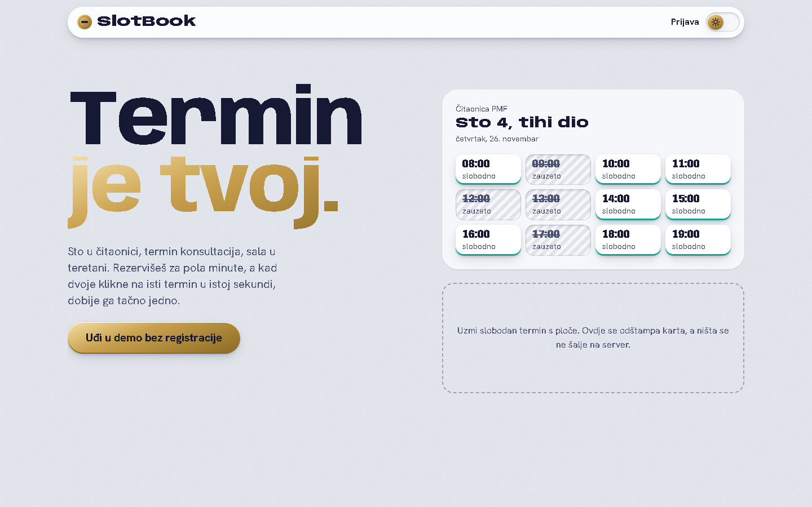 | 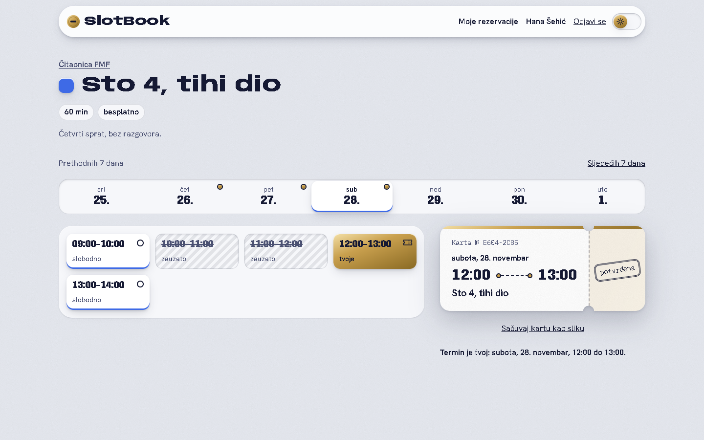 |
| **Moje rezervacije, tamna tema** | **Statistika organizacije** |
| 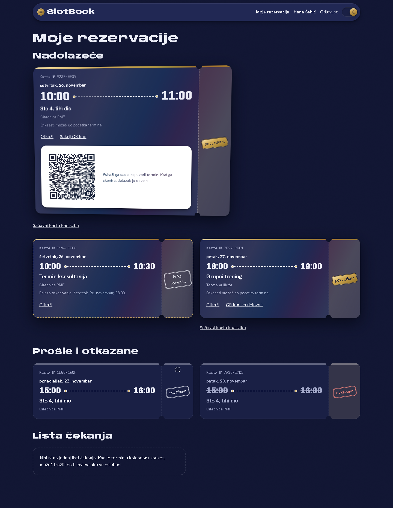 | 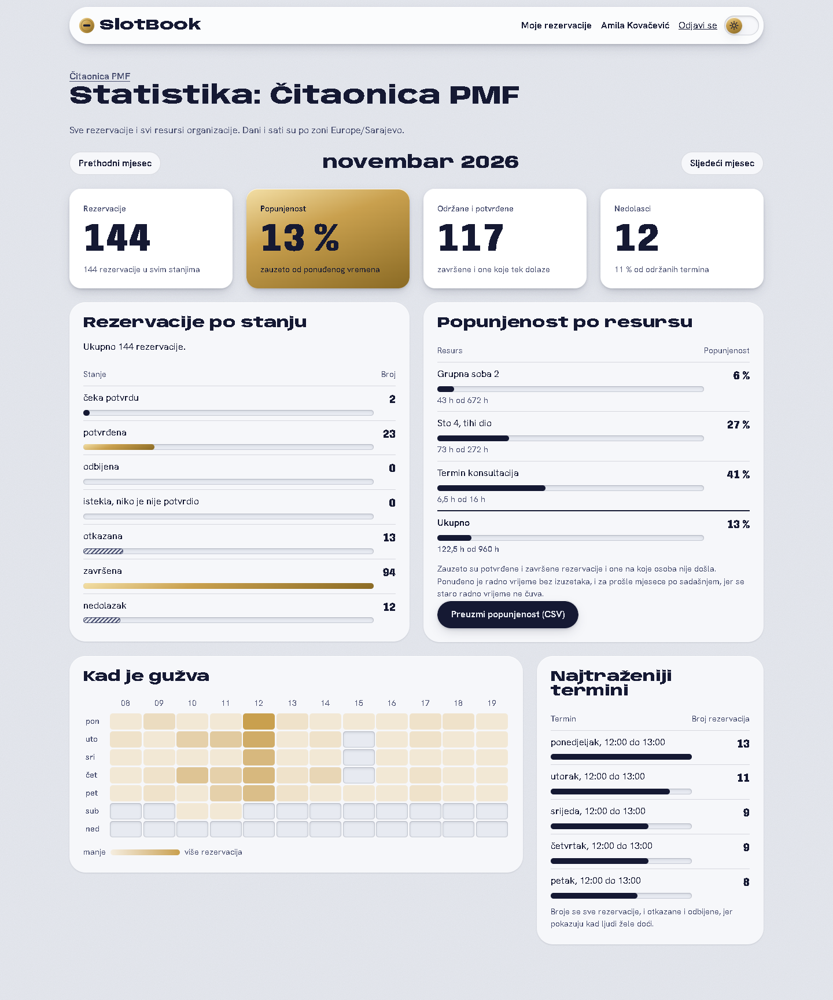 |
| **Telefon: kalendar** | **Telefon: organizacije** |
| 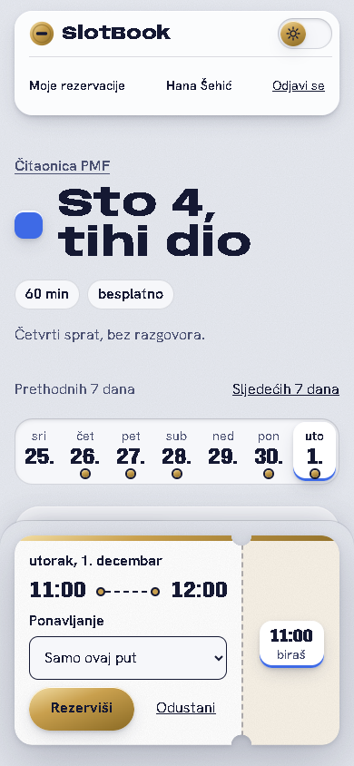 | 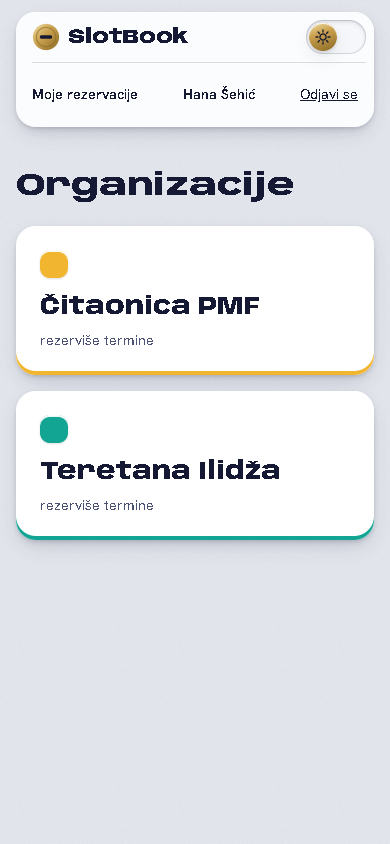 |

Svi screenshotovi, i oni od prije redizajna, su u [redizajn/](redizajn/).

## Dodaci prije Faze 13

Šest dodataka, svi gotovi 26.11.2026. Plan je u [PROJECT_PLAN.md](../PROJECT_PLAN.md), pod "Dodaci prije Faze 13".

Lozinka mora imati najmanje 10 znakova, bez nizova s tastature, bez čestih lozinaka i bez emaila. Pravila su po NIST-u, umjesto starog "veliko slovo, broj i znak". Uz to sam konačno napravio stranice za zaboravljenu i novu lozinku, jer je link iz maila do tada vodio na 404.

Admin može napraviti pozivni link s brojem mjesta i rokom i poslati ga u grupu ili odštampati A4 plakat s QR kodom. Ko otvori link, ulazi kao klijent. Dvadeset istovremenih ulazaka na link s pet mjesta pusti tačno pet. Admin od tada mijenja uloge, uklanja članove i povlači pozivnice. Zadnji admin se ne može spustiti ni ukloniti, a član koji vodi resurse ne može dok ih ne preda. Uklonjenom članu se buduće rezervacije otkazuju, uz mail.

Resurs može imati pravila korištenja: koliko budućih rezervacija smije imati jedna osoba, koliko dana unaprijed se rezerviše i koliko najkasnije prije početka. Organizacija može uvesti pravilo "toliko nedolazaka u toliko dana daje blokadu od toliko dana". Pravila važe za klijente i provjeravaju se pod istim lockom resursa kao i rezervacija. Osam istovremenih rezervacija iste osobe, uz granicu od tri, pusti tačno tri.

Ekran na vratima je tajni link za tablet ili TV pored vrata. Bez prijave pokazuje sat, termin u toku, sljedeći, ostatak dana i QR kod pozivnog linka. Osvježava se sam preko SSE-a, ne gasi se (Wake Lock) i ne pokazuje nijedno ime, što test provjerava na samom JSON-u.

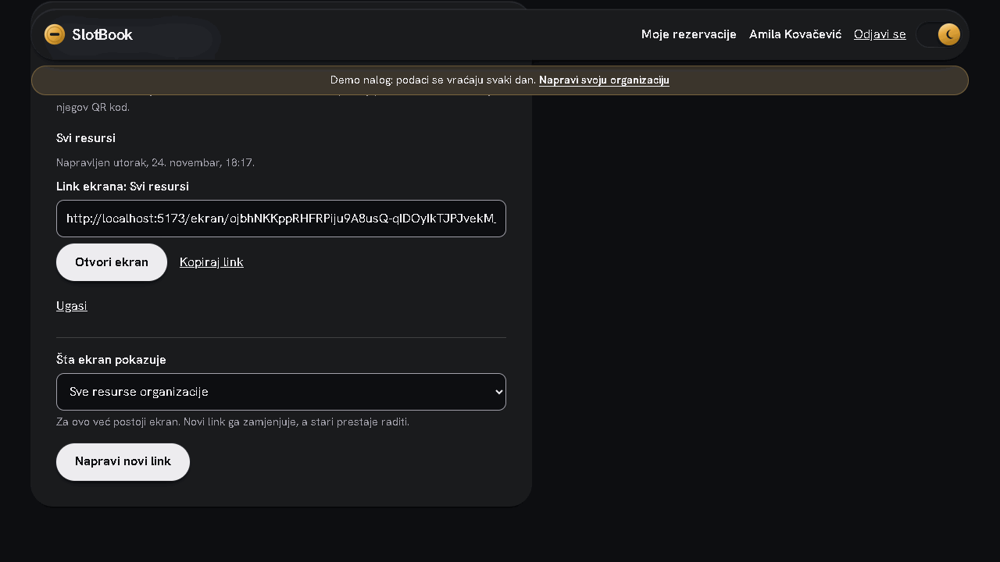

U GIF-u admin otvori ekran u postavkama, klijent s telefona rezerviše 19:00, ekran se sam osvježi i sljedeći termin postane zauzet, a QR kod s ekrana vodi na pozivni link.

"Nađi slobodno" je na stranici organizacije. Brzi izbori (sad, danas poslije 16h, sutra ujutro, sutra poslije podne) pokažu slobodne termine svih resursa po satu, a klik otvori kalendar resursa s tim terminom. U traci dana kalendara ispod svakog dana piše koliko je termina slobodno.

SlotBook je postao PWA (manifest, ikone, service worker samo za statiku, stranica "nema mreže"). Ponuda s liste čekanja, potvrda, odbijanje i podsjetnik stižu i kao push obavijest, kroz isti outbox i s istim ponovnim pokušajima kao mail. Obavijesti se uključuju na stranici Moj nalog, posebno za svaki uređaj. Bez `VAPID_PUBLIC_KEY` i `VAPID_PRIVATE_KEY` push je isključen, a sve ostalo radi. Ključevi se prave jednom, sa `npx web-push generate-vapid-keys`. Zašto baš tako, piše u [ODLUKE.md](ODLUKE.md).

| Nađi slobodno, telefon | Kalendar otvoren iz "Nađi slobodno" |
|---|---|
| 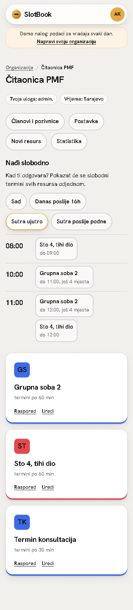 | 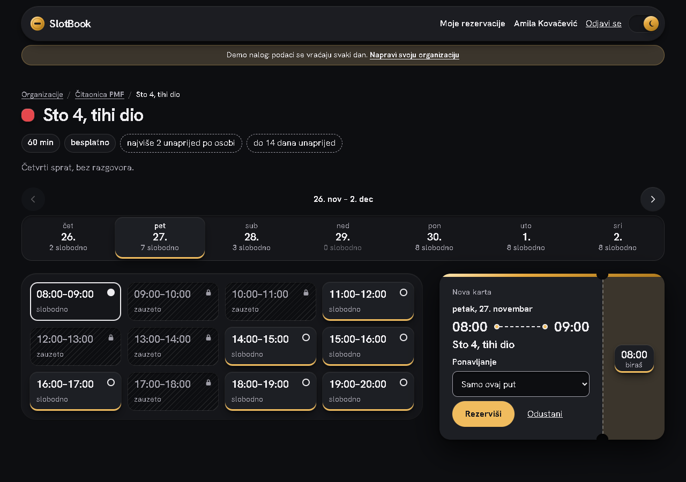 |
| **Postavke: nedolasci i ekran na vratima** | **Obavijesti na ovom uređaju i "nema mreže"** |
| 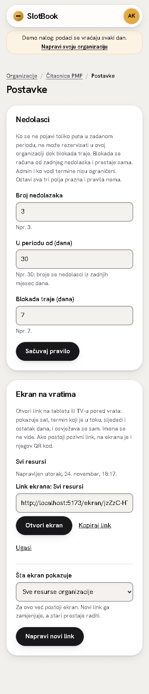 | 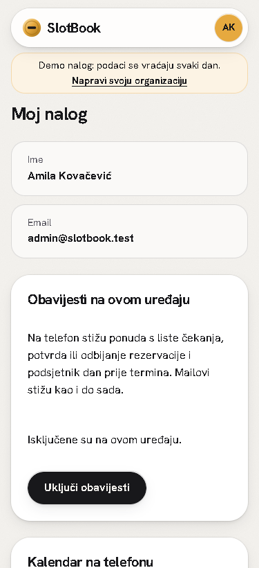 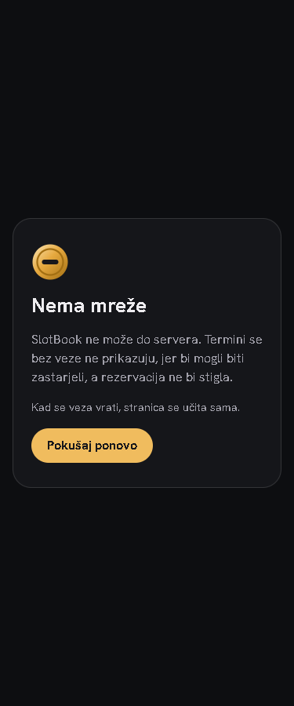 |

## Faza 13: završni pregled

Tri koraka, 26.11.2026. Prvi je čišćenje: mrtvi kod i upozorenja kompajlera i linta. Drugi je pregled koda od Faze 10 nadalje. Našao je četiri greške, a peta se pokazala u testu za jednu sitnicu: podsjetnik je padao čim neko ima uključen push. Svaka je dobila test koji je prvo pao, a popravke su migracije V46 i V47 ([ODLUKE.md](ODLUKE.md)). Treći korak je bio prolaz kroz README i `docs/`. Engleski prijevod UI-ja je iz plana ove faze prebačen u Dodatke.
